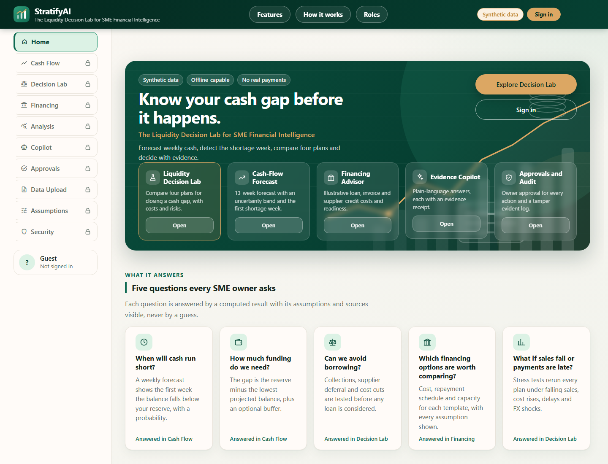
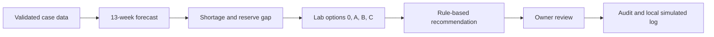
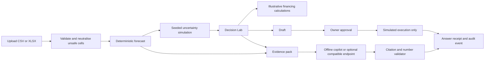
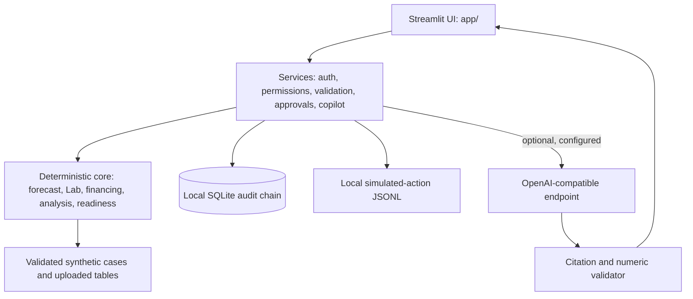

# StratifyAI

## The Liquidity Decision Lab for SME Financial Intelligence

  [](https://github.com/Rafiqul-Islam12/stratifyai/actions/workflows/ci.yml)   

*2026 Shenzhen International FinTech Competition, International Track, Topic E: SME Finance Copilot.*

> **Synthetic data only. Financing terms are illustrative. No financial advice, real lender connection, loan application, or payment is provided.**



This is a current 1440px browser capture of the public Overview.

StratifyAI helps SME owners see a projected cash shortage and compare explicitly hypothetical responses. Deterministic Python code computes balances, plans, costs and readiness indicators. The optional copilot explains only a validated evidence pack. Owner approval is required before a draft can be marked as simulated execution.

## Try it in 60 seconds

From Python 3.11+:

```bash
python run.py setup
python run.py demo
```

The local demo uses synthetic accounts for `owner`, `finance_ops`, `viewer` and `auditor`. Use the page's labelled **DEMO** quick-sign-in buttons; local demo passwords are configurable in `.env`. After sign-in, click **Load demo business**, then open **Decision Lab**. No credentials or API key are needed in offline mode.

## The problem

SME owners can discover a cash shortage only after a customer payment is late or a bill comes due. StratifyAI turns recorded synthetic transactions, invoices, bills and editable assumptions into a dated cash view with explicit uncertainty and owner-controlled what-if plans.

## Five questions the app answers

| Owner question | Where to look |
| --- | --- |
| When could cash fall below the minimum reserve? | Cash Flow and Overview |
| Which collection, supplier-deferral or discretionary-spend change affects the gap? | Decision Lab |
| Is borrowing needed under the selected assumptions? | Decision Lab recommendation |
| What would an illustrative facility cost and how would it repay? | Financing |
| What data supports the answer, and what is missing? | Analysis, Readiness and Copilot evidence receipt |

## Flagship: Liquidity Decision Lab

| Plan | What changes | Layer |
| --- | --- | --- |
| Option 0 | Baseline; no intervention | FORECAST |
| Option A | Apply selected L1 collections, L2 payable rescheduling and/or L3 discretionary-spend reduction | HYPOTHETICAL |
| Option B | Option A plus financing sized to its remaining gap | HYPOTHETICAL |
| Option C | Finance the original gap without Option A | HYPOTHETICAL |

Every lever is modelled separately and in combination. A plan is feasible only when its deterministic minimum balance keeps the configured reserve. When no plan meets that condition, the result says so and selects the smallest remaining gap. The uncertainty model reports breach probability separately. Financing amounts, capacity and costs are illustrative, editable estimates.

The current Overview screenshot appears above. A dedicated 1440px Decision Lab capture will be added at `docs/img/lab.png` after the signed-in view is captured.



## How it works



**Code computes, the AI explains.** Forecasts, financing calculations, scenario changes, permissions and audit records run in Python services; the copilot has no action-execution tool.

## Features

| Feature | What it does | Why it matters |
| --- | --- | --- |
| Forecast and alerts | Separates ACTUAL from FORECAST; estimates reserve breach, funding gap and P10/P50/P90 paths | Shows timing and uncertainty, not a single unsupported certainty |
| Decision Lab | Computes baseline, three isolated levers, combined changes and Options A/B/C | Makes the assumptions and trade-offs inspectable |
| Financing | Compares illustrative templates, cost, schedule, capacity indicator and risks | Avoids implying a lender offer or approval |
| Analysis | Shows evidence-backed cash-flow, receivable, payable and data-quality metrics | Marks unsupported metrics unavailable with a reason |
| Agent actions and approvals | Saves drafts; owner can approve/reject and record local simulated execution | Human review is explicit; no external action is sent |
| Copilot | Answers bounded questions from masked, computed evidence; offline by default | Citations and numeric validation constrain explanations |
| Security and audit | Backend role checks, sanitized append-only hash chain, upload validation and audit verification | Permission checks do not rely on UI labels alone |

## Architecture



```text
core/       Pure calculations and typed synthetic data.
services/   Authentication, backend authorization, validation, audit, drafts and copilot.
app/        Streamlit shell, pages, charts and self-hosted CSS.
data/       Synthetic case generator and generated cases.
tests/      Unit, service and Streamlit AppTest coverage.
scripts/    Setup checks, evaluation, task workflows and report generation.
evidence/   Recorded evaluation, test and sandbox artifacts.
docs/       Product, design, task and submission documentation.
demo/       Judge questions, expected results and CSV examples.
```

See [Technical Documentation](docs/TECHNICAL_DOC.md) for data flow, formulas and state transitions.

## Security and compliance

| Tier | Meaning | Who may use it |
| --- | --- | --- |
| READ | View data, results, copilot answers and permitted audit records | Role-specific; see self-assessment |
| DRAFT | Upload validated data, run scenarios and create drafts | owner, finance_ops |
| APPROVAL_REQUIRED | Approve/reject a draft or mark approved work as simulated | owner only |
| MONEY_MOVEMENT | Transfer or transmit funds | Always denied for every role |

| Role | Summary |
| --- | --- |
| owner | All read and draft tasks, manage assumptions, approve/reject and simulate |
| finance_ops | Read, upload, run Lab and create/submit own drafts; cannot approve |
| viewer | Read-only access to permitted pages |
| auditor | Read and verify audit history; no draft approval or execution |

SQLite audit events are sanitized, append-only under local triggers and linked with SHA-256 previous-record hashes. The verifier detects changed, missing or reordered records; it does not prevent a database administrator from editing the file. Uploaded text is untrusted, formula-like cells are neutralized, and Copilot evidence excludes names and free text. The app does not execute payments, loan applications or real integrations.

See [Security Self-Assessment](docs/SECURITY_SELF_ASSESSMENT.md) for implementation locations, test references, STRIDE coverage and residual risks.

## Evaluation evidence

Evidence comes from the checked-in synthetic evaluation artifacts dated 2026-10-18. It is not production validation.

| Evaluation | Observed result |
| --- | --- |
| Unit and AppTest suite | 197 passed (`evidence/test_results.txt`) |
| Scripted service workflows | 13/13 passed (`evidence/task_suite_results.md`) |
| Role/action authorization matrix | 60 decisions matched (`evidence/security_eval.md`) |
| Injection and grounding | 10/10 poisoned-name cases excluded; grounded answers validated with 10 evidence receipts |
| Audit tamper check | Tampering detected at entry 1 |
| Reserve decision-quality check | 1/5 recommended plans kept the reserve; 4/5 did not |
| Synthetic holdout backtest | Model MAE was higher than the naive last-four-week baseline on all five cases |

The backtest used 10-week holdouts (training cutoff 2026-05-04). For example, stable_healthy model MAE was BDT 255,370.86/week versus BDT 32,631.25/week for the naive baseline; delayed_customer_payments was BDT 297,374.47 versus BDT 18,340.14. These small synthetic results show the baseline outperforming this forecast; they do not support an accuracy claim. Review [backtest details](evidence/backtest_results.md), [decision quality](evidence/decision_quality.json) and the [evidence index](docs/EXECUTION_EVIDENCE.md).

## Competition fit and submission map

| Scoring criterion | Weight | Evidence |
| --- | ---: | --- |
| Task completion | 40% | `evidence/task_suite_results.md`, `docs/DEMO_SCRIPT.md` |
| Security and compliance | 30% | `docs/SECURITY_SELF_ASSESSMENT.md`, `evidence/security_eval.md` |
| Innovation and interaction | 30% | `app/pages/lab.py`, `app/pages/copilot.py`, `docs/DECK_OUTLINE.md` |

| Deliverable | Path / status |
| --- | --- |
| Source, README, tests | This repository; tests listed in `evidence/test_results.txt` |
| Technical documentation | `docs/TECHNICAL_DOC.md` |
| Security self-assessment | `docs/SECURITY_SELF_ASSESSMENT.md` |
| Presentation outline, max 10 min | `docs/DECK_OUTLINE.md` |
| Optional demo video script, max 5 min | `docs/DEMO_SCRIPT.md` |
| Execution evidence | `docs/EXECUTION_EVIDENCE.md`, `evidence/` |

## Quick start

Prerequisites: Python 3.11+ and a working local terminal. The pinned runtime dependencies are in `requirements.txt`.

```bash
python run.py setup
python run.py demo
python -m pytest -q
python run.py eval
python run.py report
python run.py check
python scripts/run_tasks.py
```

For a server without the browser-opening helper, use `python run.py start`; stop it with Ctrl-C. The app serves at `http://127.0.0.1:8501`. Docker packaging is planned for T17 and is not included yet. Optional environment settings are listed below and in [.env.example](.env.example). Do not place credentials in chat or commit `.env`.

| Variable | Default / purpose |
| --- | --- |
| `COPILOT_MODE` | `offline`; optional `llm` mode requires a compatible endpoint |
| `COPILOT_BASE_URL` | Empty; configured endpoint base URL |
| `COPILOT_MODEL` | Empty; configured model name |
| `COPILOT_API_KEY` | Empty; provider secret in ignored `.env` |
| `DEMO_OWNER_PASSWORD` | Empty uses the labelled local demo default |
| `DEMO_FINANCE_OPS_PASSWORD` | Empty uses the labelled local demo default |
| `DEMO_VIEWER_PASSWORD` | Empty uses the labelled local demo default |
| `DEMO_AUDITOR_PASSWORD` | Empty uses the labelled local demo default |
| `STRATIFY_AUDIT_DB` | `data/audit.sqlite3` |
| `STRATIFY_AGENT_ACTIONS_DB` | Local agent-draft SQLite path |
| `STRATIFY_SANDBOX_LOG` | Local JSONL simulated-action log path |

## Demo materials

Use [the demo script](docs/DEMO_SCRIPT.md), [judge questions](demo/judging_questions.md), [expected results](demo/expected_results.md) and the four sample CSV files in `demo/`. The demo runs offline with synthetic data. The optional LLM mode may send the masked evidence pack and question to the endpoint configured by the user.

## Documentation map

| Document | Purpose |
| --- | --- |
| `docs/BRIEF.md` | Product brief |
| `docs/PLAN.md` | Task plan and status |
| `docs/CHECKLIST.md` | Coverage matrix |
| `docs/DECISIONS.md` | Defaults, formulas and assumptions |
| `docs/SECURITY.md` | Security baseline and roles |
| `docs/TECHNICAL_DOC.md` | Architecture, algorithms and data flow |
| `docs/SECURITY_SELF_ASSESSMENT.md` | Threat model, code/test mapping and residual risks |
| `docs/DECK_OUTLINE.md` | Timed presentation plan |
| `docs/DEMO_SCRIPT.md` | Click-by-click optional video plan |
| `docs/EXECUTION_EVIDENCE.md` | Evidence artifact index |
| `docs/COMPETITION.md` | Competition facts and scoring weights |
| `docs/DESIGN.md` | UI design system |

## Scope and known limitations

- All provided cases and reported evaluation results are synthetic.
- The backtest MAE exceeds the naive baseline on all five evaluated cases; the forecast needs further calibration and broader validation.
- The reserve decision-quality check found a reserve-maintaining recommended plan for only 1 of 5 cases.
- Financing templates and readiness values are editable illustrations, not lender terms or approval predictions.
- Demo authentication has no MFA or production identity provider; password-free demo shortcuts are for local demonstration only.
- Optional LLM mode depends on a user-configured provider. Offline mode is the default; the external provider's availability, retention and reachability are outside this repository's control.
- Single-process local prototype; no real bank, payment, lending or external business-system integration.
- `docs/img/overview.png` is a current 1440px public Overview capture; dedicated 1440px captures of the signed-in pages remain to be added.
- `python run.py status` has a known status-script stdout error; the remaining quick-start commands are the supported path while it is corrected.

### Roadmap (future work)

T17 packaging and T18 final QA remain: Docker, secret-safe submission archive, clean-clone validation, current UI screenshots and submission checklist. Forecast calibration, production-grade identity, rate limiting, provider privacy review and any real integration require separate validation and authorization.

## Team, credits and licence

- Team name and members: **[fill in before submission]**
- Original work: StratifyAI project code and documentation. Third-party runtime libraries are listed in `requirements.txt`; review their licences for the final submission.
- Repository licence: **not declared yet**; choose and add an appropriate licence before public release.

No code or prose from another team is included.