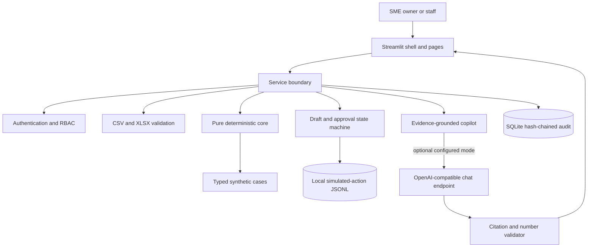
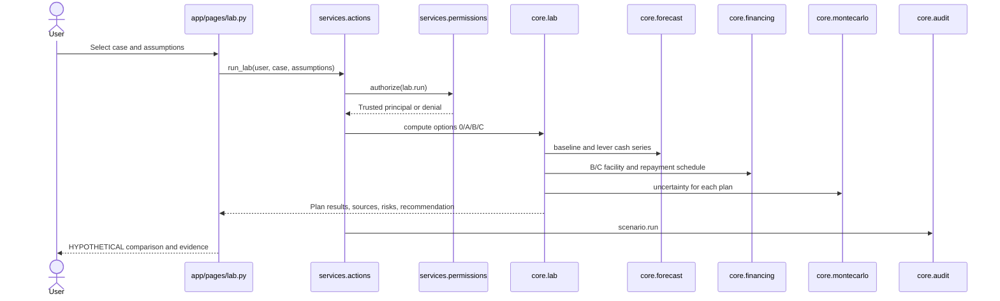
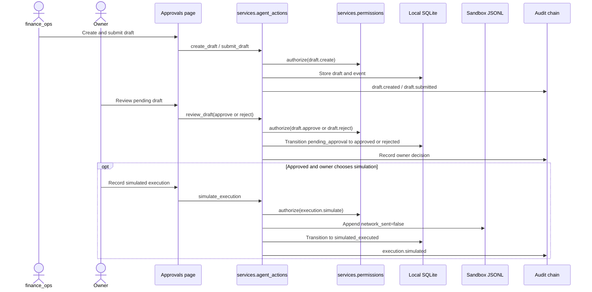
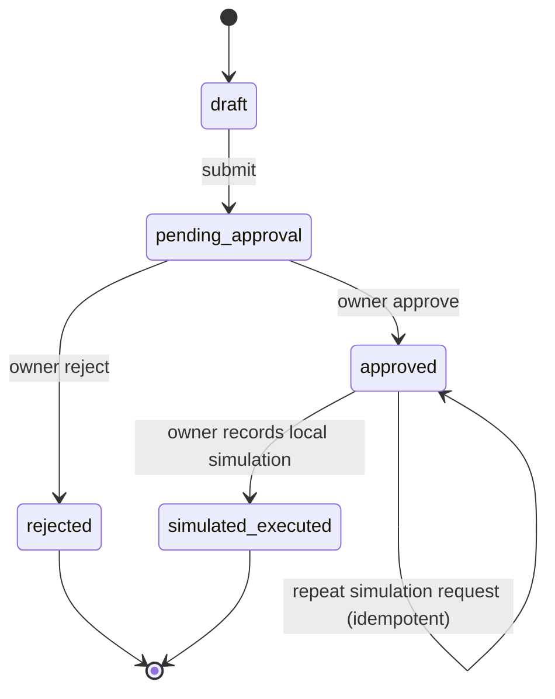

# StratifyAI Technical Documentation

## System architecture



`app/` owns Streamlit rendering and navigation. `services/` is the authorization and mutation boundary. `core/` contains deterministic calculation functions and typed data structures without Streamlit imports. Synthetic case files live under `data/`; generated evaluation artifacts live under `evidence/`.

## Data flow

1. A user loads one of five generated synthetic cases or uploads CSV/XLSX tables.
2. `services.validation.validate_upload` enforces type, byte, row, text, date, amount, required-column, duplicate and currency checks. Formula-like cells are prefixed with an apostrophe and reported; uploaded content is never executed.
3. Validated records are mapped to typed models in `core/schema.py` and `core/loaders.py`. Pages display the synthetic-data and illustrative-term labels.
4. `core.forecast.forecast` builds ACTUAL history and a separate FORECAST horizon from transaction, receivable, payable and configured assumption data.
5. `core.montecarlo.simulate` samples timing and inflow variability to produce P10/P50/P90 balances and reserve/zero breach probabilities. A fixed seed makes the default run repeatable.
6. `core.lab.run_lab` applies HYPOTHETICAL levers to a copy of the forecast and compares options. `core.financing.calculate_financing` estimates illustrative schedules and costs.
7. `services.copilot.build_evidence_pack` computes a compact, masked pack from the validated case and selected assumptions. Answers are citation- and number-checked before display; the default answerer is deterministic and offline.
8. Drafts and approval events are written to local SQLite. Approved action simulation appends a local JSONL record with `network_sent: false`; it does not call an external service.

The semantic layers remain separate: ACTUAL is recorded history; FORECAST is computed output; HYPOTHETICAL is an unapproved scenario; CONFIRMED means an owner-approved assumption, not an independently verified business fact.

## Sequence: Lab run



## Sequence: draft, approval and simulated execution



## Agent-action state machine



Invalid transitions are rejected. Submission and review are idempotent where implemented. `simulated_executed` is a local record only; `MONEY_MOVEMENT` remains denied for every role.

## Sequence: Copilot answer and validator

```mermaid
sequenceDiagram
    actor User
    participant Page as app/pages/copilot.py
    participant Service as services.copilot
    participant RBAC as services.permissions
    participant Core as Forecast, Lab, Analysis, Readiness
    participant LLM as Optional configured endpoint
    participant Check as validate_answer
    participant Audit as Audit chain
    User->>Page: Ask bounded question
    Page->>Service: answer_question(user, case, question)
    Service->>RBAC: authorize(copilot.ask)
    Service->>Core: Recompute selected evidence pack
    Core-->>Service: Numeric evidence; names and free text excluded
    alt Offline default or no endpoint configuration
        Service->>Service: Build deterministic offline response
    else Optional LLM mode
        Service->>LLM: Send masked evidence and untrusted question
        LLM-->>Service: Candidate answer
        Service->>Check: Require known citations and grounded numeric literals
        Check-->>Service: Pass or safe offline fallback
    end
    Service->>Audit: Query SHA-256 and receipt, not raw question
    Service-->>Page: Answer, evidence and receipt
    Page-->>User: Render answer and evidence IDs
```

## Core algorithms

### Forecast

`core.forecast.forecast` groups recorded transactions into Monday-start weekly ACTUAL rows and starts the projected horizon after the last actual week. It estimates inflow/outflow category run rates from the last eight weeks, but excludes invoice or bill categories when those records exist to prevent double-counting. Open receivables enter at due date plus observed customer delay (median after at least three fully paid invoices) or the editable customer default. Open payables enter on their due dates. The reserve defaults to configured weeks of average fixed outflows; first below-reserve and below-zero weeks are reported separately. The funding gap is based on reserve less the minimum closing cash, with an optional buffer. See `docs/DECISIONS.md` for defaults and caveats.

### Monte Carlo uncertainty

`core.montecarlo.simulate` defaults to 2,000 runs and seed 42. It samples per-customer invoice delays from observed fully paid invoices when at least five observations exist; otherwise it uses a non-negative normal delay around the configured profile assumption. Projected receipts receive a mean-one log-normal variability multiplier. The simulation returns weekly percentiles and computed probabilities of crossing reserve or zero. Plan runs use adjusted weekly events. Sampling and receipt-amount variability are proxies, not calibrated probability forecasts.

### Liquidity Decision Lab

`core.lab.run_lab` starts from the same deterministic forecast and computes L1, L2 and L3 separately and together:

- **L1 collections:** move a configured share of eligible overdue receivables into early forecast weeks, apply an optional haircut and remove the corresponding later expected receipt to avoid double counting.
- **L2 rescheduling:** move eligible deferrable bills to later weeks and add an optional explicit fee; the payable remains an obligation, including when it falls beyond the horizon.
- **L3 expense reduction:** reduce selected discretionary payable amounts from the selected week; the reduction is a hypothetical assumption, not a verified achievable saving.

Option B applies a facility to the remaining Option A gap. Option C applies a facility to the original gap. The best-plan rule first selects a plan whose deterministic minimum balance meets reserve, then minimizes total cost; ties favor lower repayment pressure, then fewer unconfirmed assumptions. If no plan meets reserve, the result explicitly says that and selects the smallest remaining gap. Monte Carlo breach probability is reported separately and does not replace this deterministic feasibility rule.

### Financing maths

`core.financing` rounds required facilities up to the next BDT 1,000 (zero remains zero). Invoice financing grosses the rounded net need up by the chosen advance percentage. Term-loan monthly instalments use the standard annuity formula with nominal annual rate divided by 12: `payment = principal * r / (1 - (1 + r)^(-n))`, with straight principal division when `r=0`. Term-loan interest is computed on declining principal; invoice financing and supplier credit are modelled as principal due at maturity with explicit periodic/cost charges; credit-line interest uses the drawn amount and principal is due at maturity. Fees and assumptions are editable. Capacity ratio compares average weekly net operating cash flow scaled to the debt-service period with debt service. Capacity labels are editable rules of thumb, not lender criteria.

### Readiness indicator

`core.readiness.assess_readiness` combines available components with default weights: repayment capacity 35, cash buffer 25, receivable quality 20, data completeness 10 and trend 10. Missing components are excluded and the remaining weights renormalized. Scores are bounded 0–100 and include reasons and missing-information notes. It is explicitly an indicator, not an approval prediction.

### Receivables watchlist

`core.watchlist.receivables_watchlist` scores each customer from overdue balance share (40 points), amount-weighted days overdue capped at 90 days (30), payment-delay trend (20 when sufficient history exists) and share of total open receivables (10). Missing delay history is omitted and remaining weights normalized. The score lists invoice IDs and labels Normal (<30), Watch (30–60) or Urgent (>60); it is a project heuristic, not a credit score.

## Security design

- Authentication compares salted PBKDF2-HMAC-SHA256 password hashes and resolves roles server-side from the issued session token. Demo defaults and quick-sign-in buttons are for local demonstrations only.
- `services.permissions.authorize` is called at service boundaries. The registry separates READ, DRAFT, APPROVAL_REQUIRED and always-denied MONEY_MOVEMENT. UI hiding is not an authorization control.
- Uploaded CSV/XLSX data has a 5 MiB, 50,000-row and 500-character text limit, typed required-field checks and formula-prefix neutralization. Invalid rows are not accepted as a dataset.
- Copilot evidence omits customer/supplier names and free-text fields. Questions are bounded to 500 characters; answers require known evidence IDs and every numeric literal must match computed evidence. Provider failure or invalid output falls back offline.
- Audit payloads are sanitized and size-limited, appended to SQLite with SHA-256 previous-record links, and protected by local update/delete triggers. Chain verification detects tampering; it is not immutable storage against a database administrator.
- Action drafts require owner approval before simulated execution. The copilot cannot execute actions. Simulated execution writes only to local JSONL and states `network_sent: false`.

See `docs/SECURITY_SELF_ASSESSMENT.md` for test references, STRIDE coverage and residual risks.

## Configuration reference

| Variable | Purpose | Default / handling |
| --- | --- | --- |
| `COPILOT_MODE` | `offline` or optional `llm` | `offline` |
| `COPILOT_BASE_URL` | OpenAI-compatible base URL | Unset; never send a real key through chat |
| `COPILOT_MODEL` | Endpoint model name | Unset |
| `COPILOT_API_KEY` | Endpoint bearer secret | Unset; keep in ignored `.env` |
| `DEMO_OWNER_PASSWORD` | Local owner demo password | Uses labelled local default if unset |
| `DEMO_FINANCE_OPS_PASSWORD` | Local finance_ops demo password | Uses labelled local default if unset |
| `DEMO_VIEWER_PASSWORD` | Local viewer demo password | Uses labelled local default if unset |
| `DEMO_AUDITOR_PASSWORD` | Local auditor demo password | Uses labelled local default if unset |
| `STRATIFY_AUDIT_DB` | SQLite audit path | `data/audit.sqlite3` |
| `STRATIFY_AGENT_ACTIONS_DB` | Agent draft database path | Local default from service |
| `STRATIFY_SANDBOX_LOG` | Simulated action JSONL path | `evidence/sandbox_log.jsonl` |

## Key decisions

- Weekly Monday buckets, BDT currency and a 13-week default forecast horizon (minimum 8 weeks).
- Reserve defaults to two weeks of average fixed outflows; buffer defaults to zero.
- Invoice and bill categories are excluded from duplicate category run rates when detailed records exist.
- The uncertainty model uses 2,000 seeded runs; it is deterministic for the same inputs and seed.
- Facility amounts round up to the next BDT 1,000; invoice financing grosses up by advance rate.
- Best plan is deterministic feasibility then lowest cost, with explicit tie-breaks; stochastic breach probability is additional context.
- Copilot defaults offline and is read-only. Optional LLM mode is generic OpenAI-compatible and configured only by local environment values.
- No live payment, lending, bank, or lender integration is implemented.

Full assumptions and rationale: `docs/DECISIONS.md`.

## Evaluation method and observed results

`evidence/backtest_results.md` documents a synthetic holdout using the final 10 weeks (per-case last eight weeks or last 25% when longer); model forecast uses training data up to the recorded cutoff and is compared with the naive last-four-week mean net flow. The evidence records higher MAE for the model on all five cases. The backtest is small, synthetic and not evidence of general accuracy.

Other checked-in evidence reports 197 passing tests, 13/13 scripted service workflows, 60/60 role/action decisions, 10/10 injection strings excluded from evidence, tamper detection at audit entry 1 and 1/5 reserve-maintaining recommended plans. See `docs/EXECUTION_EVIDENCE.md`; the evidence timestamp is 2026-10-18.